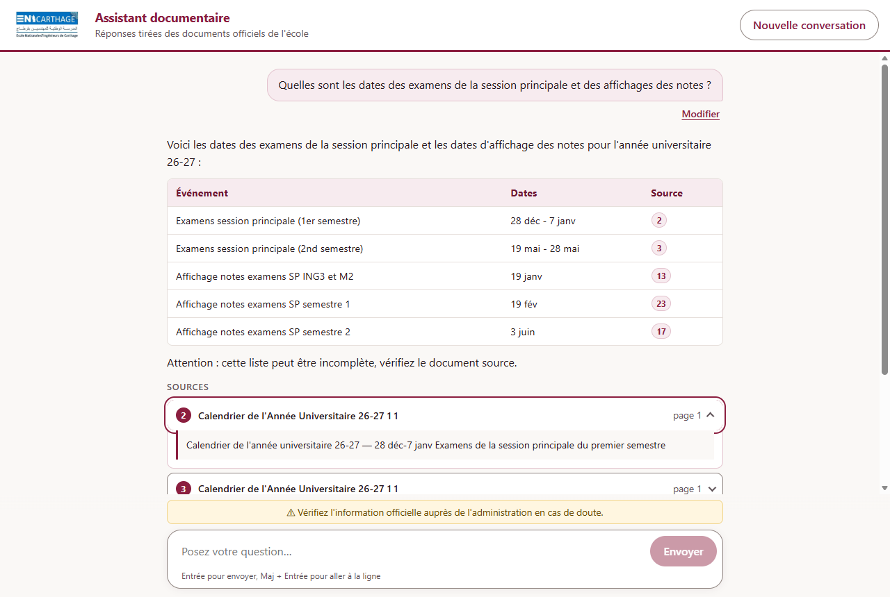

# ENICarthage documents assistant (RAG)

A chat assistant that answers students' questions from the school's official documents
(study plans, academic calendar, student guide, internship forms). Every answer **cites its source**
(file and page), and the assistant **refuses to answer** when the documents don't contain the information.


<!-- TODO: add docs/screenshot.png (the app answering a question, ideally with a cited source). -->

## How it works

```
 PREPARATION (once, offline)
 ┌────────────┐   ┌──────────────────────────────┐   ┌──────────────────────┐
 │ documents/ │──▶│ chunk_documents.py           │──▶│ chunks.json          │
 │ PDF, DOCX  │   │ study plan → 1 line / course │   │ text, source, page,  │
 └────────────┘   │ calendar   → 1 line / event  │   │ status (actuel /     │
       ▲          │ guide      → 1 chunk/article │   │ archive)             │
       │          │ other      → 800-char pieces │   └──────────┬───────────┘
 documents_       └──────────────────────────────┘              │
 status.json                                         embed_chunks.py
 (actuel/archive)                                   (multilingual-e5-small)
                                                                ▼
                                                     ┌──────────────────────┐
                                                     │ embeddings.npy       │
                                                     │ 384 numbers / chunk  │
                                                     └──────────┬───────────┘
 EACH QUESTION (app.py / ask.py)                                │
 ┌──────────┐   ┌─────────────────────┐   ┌─────────────────────▼──────────┐
 │ question │──▶│ clean-up            │──▶│ retrieve (build_prompt.py)     │
 └──────────┘   │ CAPS, accents,      │   │ cosine similarity              │
                │ typos, CC/SR/PFE... │   │ 8 chunks, 25 for "list all"    │
                └─────────────────────┘   │ archived docs left out unless  │
                                          │ the question asks about the past│
                                          └─────────────────────┬──────────┘
                                                                ▼
 ┌─────────────────────────────┐   ┌──────────────────────────────────────┐
 │ answer + cited file / page  │◀──│ Gemini: rules + numbered excerpts    │
 │ (Streamlit chat)            │   │ "answer only from the excerpts, cite │
 └─────────────────────────────┘   │ [n], otherwise say you don't know"   │
                                   └──────────────────────────────────────┘
```

## Install and run (Windows, PowerShell)

The school documents are **not** included in the repository. Put your own PDFs in a `documents/` folder.
File names matter: study plans start with `PE_`, the calendar with `Calendrier`, the guide with `Guide_`
(any other file is cut into plain text pieces).

```powershell
python -m venv .venv
.venv\Scripts\Activate.ps1          # cmd.exe: .venv\Scripts\activate.bat
pip install -r requirements.txt

python chunk_documents.py           # documents/ -> chunks.json
python embed_chunks.py              # chunks.json -> embeddings.npy (downloads the model the first time)
```

If PowerShell refuses to run `Activate.ps1`, run once:
`Set-ExecutionPolicy -Scope CurrentUser RemoteSigned`.

Get a free Gemini API key from Google AI Studio, then:

```powershell
Copy-Item .env.example .env
notepad .env                        # GEMINI_API_KEY=your_key
streamlit run app.py                # opens http://localhost:8501
```

Command line, without the interface:

```powershell
python ask.py "quand est le forum des entreprises"
python build_prompt.py "ta question"   # shows the retrieved chunks, writes prompt.txt, no API call
python evaluate.py                     # retrieval scores, no API call
```

## Adding or archiving a document

`documents_status.json` says, for each file in `documents/`, whether it is still in force.
It is edited by hand; no Python change is needed.

```json
"Plaquette_Dep_Informatique_2017.pdf": {
  "status": "archive",
  "annee_scolaire": "2017",
  "note": "Describes 3rd-year specialities that no longer exist."
}
```

- `"actuel"`: used to answer.
- `"archive"`: left out of the search, **unless** the question asks about the past
  (`ancien`, `avant`, `archive`, `précédent`, `en 2017`...). When an archived excerpt is used,
  the answer says that it comes from an old document.

**Add a document:** copy the file into `documents/`, add an entry in `documents_status.json`,
then run `python chunk_documents.py` and `python embed_chunks.py`.
A file missing from `documents_status.json` is treated as `actuel` and a warning is printed.

**Archive a document** (for example when next year's calendar arrives): change its `status` to
`"archive"` and run `python chunk_documents.py`, then `python embed_chunks.py`.

Restart the Streamlit app after any change: the chunks are loaded once at startup.

## Evaluation results

Test set: 52 questions written by hand (`eval_questions.json`). For each question, the file and the text
that the right chunk must contain. Four types: `direct` (close to the document's wording), `paraphrase`,
`noisy` (abbreviations, no accents), `crosslingual` (question and document in different languages).

- **hit@k**: the right chunk is among the first k results.
- **MRR**: average of 1/rank of the right chunk (1 = always first).

Latest run (2026-11-09, retrieval only, the top 8 chunks go to the LLM):

| Type | Questions | hit@1 | hit@3 | hit@5 | hit@8 | MRR |
|---|---|---|---|---|---|---|
| direct | 26 | 85% | 96% | 100% | 100% | 0.901 |
| paraphrase | 16 | 62% | 75% | 75% | 75% | 0.677 |
| noisy | 7 | 71% | 86% | 100% | 100% | 0.798 |
| crosslingual | 3 | 33% | 67% | 100% | 100% | 0.511 |
| **all** | **52** | **73%** | **87%** | **92%** | **92%** | **0.796** |

Every measured change is one line in [results.md](results.md) (`python evaluate.py "what changed"`).
Design choices and the alternatives considered are in [DECISIONS.md](DECISIONS.md).

The test set is small: one question is about 2 points, so these numbers show a trend, not a guarantee.

## Known limits

- **Answers can be wrong.** Always check the cited source.
- **Only retrieval is evaluated.** The answers written by the LLM, including refusals, are not scored yet.
- **Paraphrases are the weak spot:** 4 of 16 reworded questions never get the right chunk in the top 8.
- **"List everything" questions are partial.** They get 25 chunks, but the calendar alone has 50 lines:
  "toutes les dates du calendrier" returns part of them, with a warning that the list may be incomplete.
- **Vocabulary mismatch.** "Les options en 3ème année informatique" is refused: the current study plan
  never says "option" (it uses "Panier SI / Rx / Emb"), and the footnote that explains the choice is lost
  by the table parser.
- **The typo fixer can rewrite correct words** that are absent from the documents ("Quel" → "Que").
  It brings no measurable gain on the test set, which contains no real typos.
- **Archive detection is a word list.** A question about the past without one of those words won't see
  archived documents; a current question containing "avant" will.
- **No OCR:** scanned PDFs are not read.
- **Short memory:** the chat only remembers the previous question.
- **Free Gemini tier:** rate limits. The app tries several models in turn and shows a clear message
  when all are busy.
- **Parsers depend on file names and layouts** (`PE_`, `Calendrier`, `Guide_`). A new layout may need
  changes in `table_chunks.py` or `article_chunks.py`.

## Files

```
app.py                 Streamlit chat interface
ask.py                 retrieval + Gemini call, model fallback, CLI entry point
build_prompt.py        query clean-up, retrieval, enumeration/archive detection, prompt rules
followup.py            merges the previous question for follow-ups ("et en 2ème année ?")
suggestions.py         question suggestions shown while the student types
config.py              reads .env

chunk_documents.py     documents/ -> chunks.json (uses documents_status.json)
table_chunks.py        study-plan tables and calendar parsers (pdfplumber)
article_chunks.py      student guide: one chunk per article
embed_chunks.py        chunks.json -> embeddings.npy
documents_status.json  actuel / archive for each document (edited by hand)

evaluate.py            hit@k and MRR on eval_questions.json, appends to results.md
eval_questions.json    52 hand-written test questions
add_question.py        helper to add a test question
results.md             history of every measured change
DECISIONS.md           design choices, alternatives, known weaknesses

debug_question.py, why.py, search.py, find_chunk.py, show_chunk.py, show_source.py,
show_page.py, test_tables.py, check_documents.py, check_years.py, list_semesters.py
                       small debugging tools (inspect chunks, pages, retrieval)

.streamlit/config.toml interface theme
public/LOGO.jpg        logo shown in the app
.env.example           template for .env (the real .env is never committed)

Not in git: documents/, chunks.json, embeddings.npy, .env, .venv/
```

## Stack

Python 3.10, pypdf, pdfplumber, python-docx, sentence-transformers (`intfloat/multilingual-e5-small`),
NumPy, Google Gemini API, Streamlit.
